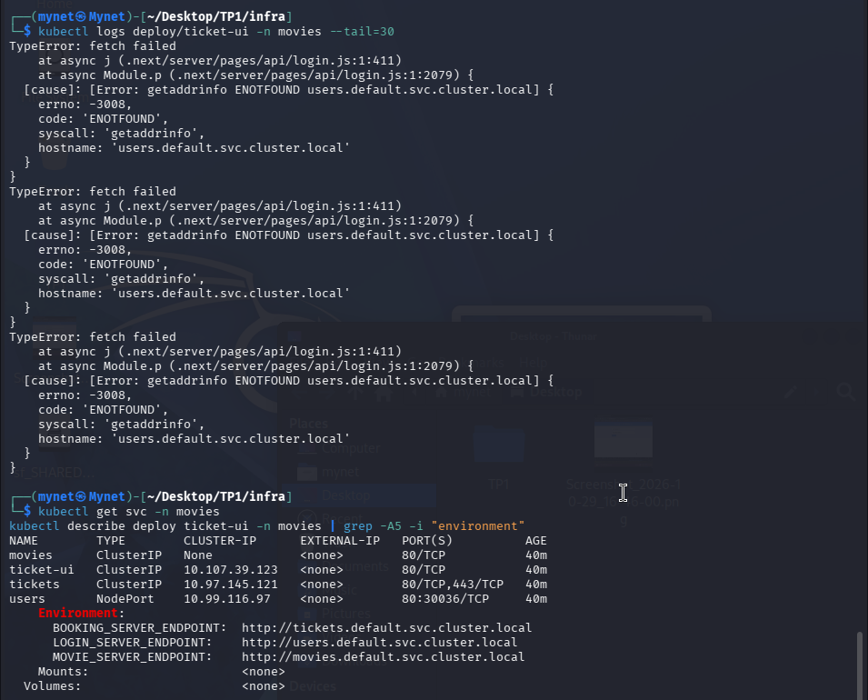
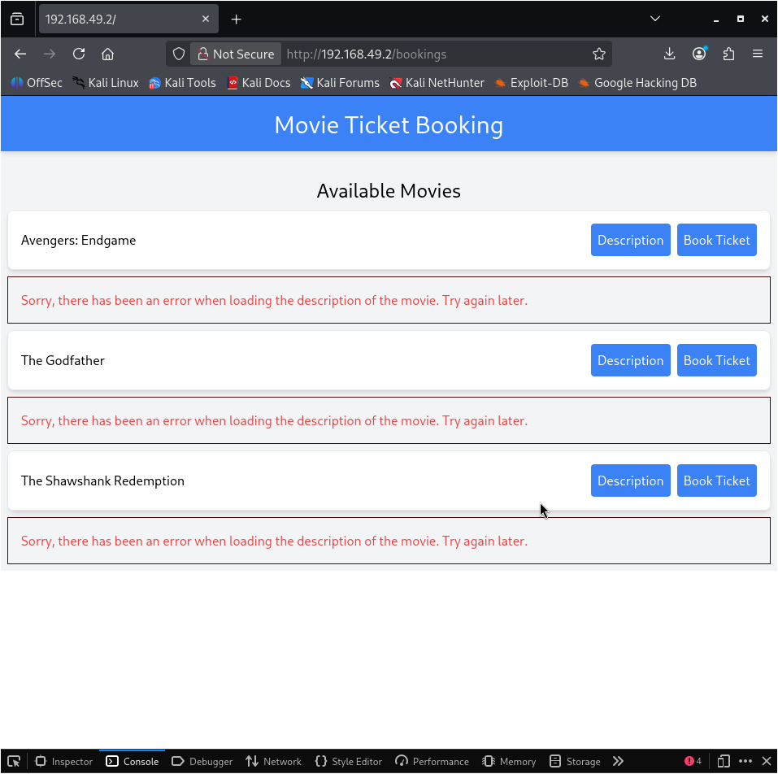
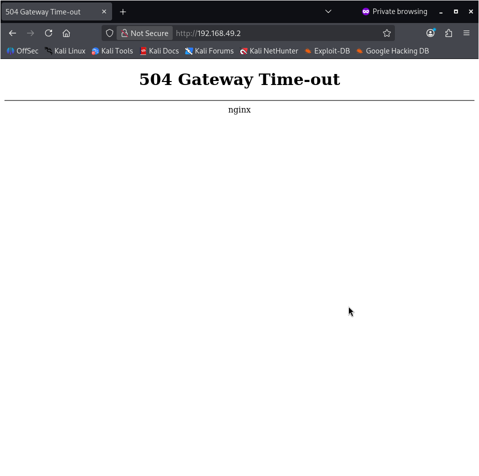
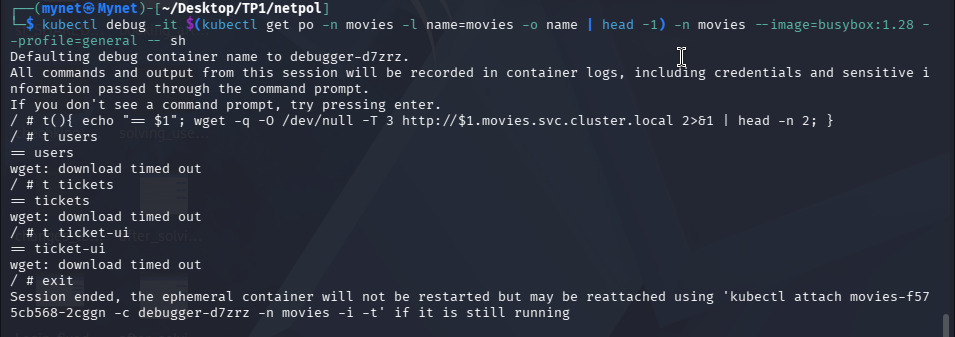
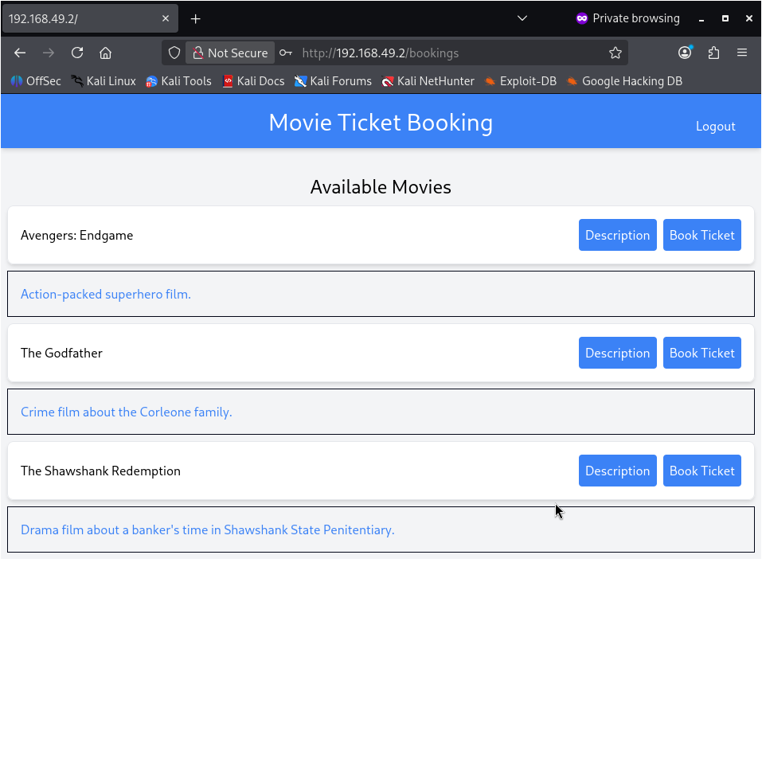

# Kubernetes Network Security Lab

Hands-on project: I fixed a broken microservice app on Kubernetes and isolated
it with NetworkPolicies. This repo contains my own policy files and write-up.

## The app
A movie-ticket demo app: a UI (`ticket-ui`) that talks to three microservices
(`tickets` for booking, `movies`, and `users` for authentication), all in the
`movies` namespace.

## Environment
Kali Linux VM (VirtualBox), minikube with the Calico CNI, ingress addon, kubectl.

## Part A: Fixing the login
**Problem:** login returned HTTP 500.
**Investigation:** the UI logs showed `ENOTFOUND users.default.svc.cluster.local`.
The UI was looking for the services in the `default` namespace instead of `movies`.
**Fix:** corrected the service URLs and re-applied the file. Login worked.

```diff
- value: "http://users.default.svc.cluster.local"
+ value: "http://users.movies.svc.cluster.local"
```

## Part B: Misconfigurations
| Problem | Why it matters | Fix |
|---|---|---|
| `tickets` service selector missing `name` | It matched pods that were not its own, so `/bookings` gave different results on each refresh | Added `name: tickets` |
| `users` service was `NodePort` | The authentication server was reachable from outside the cluster | Changed to `ClusterIP` |
| `movies` service was headless | Not a normal service for this app | Recreated it as a regular service |
| HTTPS ports 443/8443 on `tickets` and `users` | The apps listen on port 5000 | Removed the unused ports |
| Ingress without TLS | Traffic is not encrypted | Not changed (needs a certificate), noted as a risk |

## Part C: NetworkPolicies (`netpol/`)
Before any policy, every pod could talk to every other pod.
1. **Default deny** for all traffic in the namespace (`general-netpol.yml`).
   The app returned a 504, which confirmed it was working.
2. **DNS rule** so pods can still resolve service names (`dns-netpol.yml`).
3. **One policy per service**, following the target architecture:
   - UI: accepts traffic from the Ingress only, and connects only to tickets, users and movies.
   - tickets and movies: accept traffic only from the UI.
   - users: accepts traffic only from the UI and tickets.
   - movies and users cannot start connections to other services.

## Testing
I tested the original versions of these policies in a minikube cluster, by opening
a shell in pods with `kubectl debug` (busybox) and running `wget -T 3` against each
service. A response (even a 404) means the connection is allowed; a timeout means
it is blocked. The UI reached the three services but not the Internet, and the
app still worked through the Ingress.

Note: the files in this repo were rewritten from my notes after I lost the
originals, and I have not re-run them yet.

## What I learned
- By default, Kubernetes lets every pod talk to every other pod.
- A default-deny policy plus small allow rules follows the least-privilege idea.
- Small YAML mistakes (a missing selector, a wrong service type) can expose a service.

## Key fixes (diff)
```diff
# tickets.yml: the service selector was missing the name label
+    name: tickets
# tickets.yml: unused HTTPS ports removed (the app listens on 5000)
-    - name: https
-      port: 443
-      protocol: TCP
-      targetPort: https
-        - name: https
-          containerPort: 8443
# users.yml: authentication server no longer exposed outside the cluster
-  type: NodePort
+  type: ClusterIP
```

## Screenshots
**Login error: the UI looks for services in the wrong namespace**


**Inconsistent /bookings results (wrong service selector)**


**Before any policy: a pod reaches every service**


**After the default deny: the app is blocked (504)**


**Connectivity test from the UI pod: three services reachable, Internet blocked**


**Final result: app working through the Ingress**

